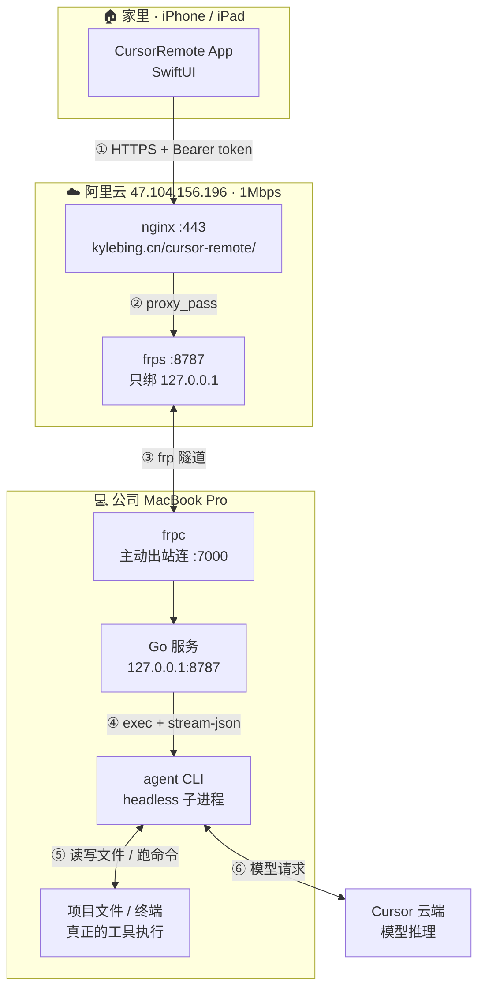

# 实现原理

这套系统做一件事：**在家里用 iPhone / iPad，向公司 Mac 上指定的 Cursor 项目下发指令，实时看它干活。**

最终验收仍然回到电脑旁做——远程只负责「下达」和「观察」，不负责「验收」。

---

## 整体链路



| 段 | 说明 |
| --- | --- |
| ① | App 走标准 HTTPS，token 放 `Authorization: Bearer`，不放 URL |
| ② | 复用现有 nginx 站点，挂 `/cursor-remote/` 路径前缀，**不需要新增 DNS 记录** |
| ③ | Mac 主动出站连 VPS，公司网络不需要开放任何入站端口 |
| ④ | Go 服务 `exec` 拉起 `agent` CLI 子进程，逐行读 stdout |
| ⑤ | 工具执行发生在**本机真实环境** |
| ⑥ | 模型推理在 Cursor 云端 |

### ⑤ 和 ⑥ 是分开的

这是整个方案能成立的关键：

- **模型推理**在 Cursor 云端（⑥），`agent login` 换来的凭据就是干这个的
- **工具执行**在你这台 Mac 上（⑤），读写文件、跑 `git`、执行 `xcodebuild` 全在本地

所以远程让它在 `wubi86-rime-ime-macos` 里改代码，改的是**本机真实文件**，编译用的是**本机连着的设备**。

这也是 Cloud Agent 做不到的——那个跑在 Cursor 的沙箱里，拿不到你的本机环境和项目目录。

---

## Cursor 这边走的是什么

**不是 IDE 自动化，也不是网页版 Agent API，而是官方 headless CLI。**

具体是一个 Node 程序：

```
~/.local/bin/agent          # bash 包装脚本，自带 node
~/.local/share/cursor-agent/versions/<版本>/index.js   # 真身，约 8MB 打包产物
```

### 调用参数

服务端在 `server/task.go` 的 `buildArgs()` 里组装：

| 参数 | 作用 |
| --- | --- |
| `-p` | 非交互模式：跑完就退，不等键盘输入 |
| `--output-format stream-json` | 输出改成**一行一个 JSON**，机器可解析 |
| `--stream-partial-output` | 逐 token 增量输出，手机上才能看到「边想边写」 |
| `--workspace <path>` | 决定 agent 在哪个项目里干活 |
| `--trust` | 信任该目录，跳过信任确认 |
| `--resume <sessionId>` | 续聊：接上同一会话的上下文 |
| `--mode plan\|ask` | 只读 / 计划模式，不落盘改动 |
| `--model <name>` | 指定模型；`auto` 或空表示用账号默认 |
| `--auto-review` | 由分类器放行安全命令，可疑的暂停（默认档位） |
| `--force` | 全部放行，不询问 |
| `--` | 结束选项解析；其后整段是用户 prompt（防止 `- 列表项` 被 CLI 当成未知参数） |

子进程环境额外设了 `NO_COLOR=1`、`TERM=dumb`、`CI=1`，避免输出里混入 ANSI 控制符干扰解析。

prompt 作为最后一个位置参数传入；若用户消息以 `-` / `--` 开头（常见于 markdown 列表），必须先写 `--`，否则 agent CLI 会报 `unknown option`。

### 子进程生命周期

- 用 `exec.CommandContext` 拉起，工作目录设为项目路径
- 停止任务时先发 **SIGINT** 让 agent 自行收尾，`WaitDelay` 到 8 秒后强制杀
- stdout / stderr 各起一个 goroutine 读：stdout 走解析器，stderr 直接作为 `stderr` 事件推给 App（登录失效这类问题在这里能看到）

---

## 流式是怎么到手机上的

`--stream-partial-output` 让 CLI 边想边吐，实测一次回答会拆成多帧：

```json
{"type":"assistant","text":"链路"}
{"type":"assistant","text":"测试"}
{"type":"assistant","text":"成功"}
{"type":"assistant","text":"。"}
```

服务端拿到 stdout 的每一行，走这条链：

```
读一行 → handleLine() 解析 → 转成 Event → emit()
                                            ├─ 追加到内存 events（带递增 seq）
                                            ├─ 追加写 events.jsonl（落盘）
                                            └─ 广播给所有 SSE 订阅者
```

`emit()` 的广播是**非阻塞**的：某个客户端太慢就先丢，等它重连时用 `after` 补齐。这样慢手机不会拖住任务本身。

### 断点续传

App 用 `GET /api/tasks/{id}/stream?after=<seq>` 订阅。

- 服务端先回放 `seq > after` 的历史事件，再接上实时通道
- 手机锁屏、切后台、网络抖动后重连，带上最后收到的 `seq`，**不丢也不重**
- 每 15 秒发一个 SSE 注释行 `: ping` 保活，防止中间层掐断空闲连接

```startLine:278:311:/Users/kyle/Developer/cursor-remote/server/api.go
	writeSSE(w, flusher, "task", t.Info())
	for _, e := range replay {
		writeSSE(w, flusher, "event", e)
	}
	flusher.Flush()

	// 任务已结束则直接收尾，避免客户端挂着一个空连接。
	info := t.Info()
	if info.Status != StatusRunning && info.Status != StatusQueued {
		writeSSE(w, flusher, "done", map[string]string{"status": info.Status})
		return
	}

	heartbeat := time.NewTicker(15 * time.Second)
	defer heartbeat.Stop()
	for {
		select {
		case e, ok := <-ch:
			if !ok {
				return
			}
			writeSSE(w, flusher, "event", e)
			if e.Type == "status" && e.Text != StatusRunning && e.Text != StatusQueued {
				writeSSE(w, flusher, "done", map[string]string{"status": e.Text})
				return
			}
		case <-heartbeat.C:
			// 心跳用 SSE 注释行，客户端会忽略。
			fmt.Fprint(w, ": ping\n\n")
			flusher.Flush()
		case <-r.Context().Done():
			return
		}
	}
```

### 带宽优化

事件里的 `raw` 字段（CLI 原始 JSON）**只落盘复盘用，不推给客户端**，推之前剥掉。实测省约 70% 流量。

单轮「重会话」（3000 字回答 + 80 次工具调用）实际传输约 **107 KB**，连续流式峰值 **21 kbps**——1 Mbps 的 VPS 占用仅 2%。

---

## 事件类型

`stream-json` 的事件格式与 **Claude Code 兼容**，所以解析器写起来很规整。`server/parser.go` 里处理的类型：

| 类型 | 说明 |
| --- | --- |
| `system` / `init` | 会话就绪，带上模型名和 cwd |
| `user` | CLI 回显的用户输入（App 已有原文，不重复渲染） |
| `assistant` | 模型输出，可能拆成多帧 |
| `tool_call` | 工具调用开始 / 结束，含工具名与参数摘要 |
| `result` | 结束态，含是否出错、耗时、结果文本 |
| `interaction_query` | 需要确认的交互请求（见下节局限） |
| `retry` / `connection` | 重试与连接状态 |
| `usage` | token 用量，不推送 |

另外服务端自己产生两类事件：`status`（queued / running / done / failed）和 `stderr`。

---

## 局限：headless 下无法逐条批准

交互确认（`interaction_query`）在 `-p` 模式下由 CLI **本地策略自动应答**，不走 stdin。

所以服务端没法把审批请求转发到手机上让你点，只能通过档位间接控制：

| 档位 | 含义 | 建议 |
| --- | --- | --- |
| `--mode plan` / `ask` | 只读，不落盘改动 | 探查代码时首选 |
| `--auto-review` | 分类器放行安全命令，可疑的暂停 | **日常默认** |
| 不传 | CLI 本地默认策略 | 较少用 |
| `--force` | 全部放行，不询问 | 确定要一路跑完时 |

这是用「能无人值守」换来的代价。恢复到「能逐条批准」就得放弃 headless，改成有交互终端的会话——那会让整个无人值守的前提消失，不值得。

---

## 网络选型：为什么没用 Tailscale

最初方案是 Tailscale，但在这台机器上撞了两个硬阻碍：

1. **网络扩展卡死**：Tailscale App 的网络扩展停在 `activated waiting for user`，系统设置里没有可点的开关（早期安装残留所致），而 SIP 已开启、无法 `systemextensionsctl reset`。
2. **与 Clash 冲突**：机器上常驻 Clash Verge（TUN + fake-IP）。fake-IP 把 `controlplane.tailscale.com` 解析到 `198.18.x.x`，而 Tailscale 走自己的 utun 不经 Clash 路由，登录流程永远卡在 `doLogin(hasUrl=false)`，连授权链接都生不出来。

两者**同处隧道层**，本质是抢同一个位置，不是配置问题。

frp 反向隧道只是一条出站 TCP，不碰路由、不和任何代理冲突，所以最终选了它。详见 [README 的网络通路章节](../README.md#网络通路家--公司)。

部署细节与踩过的坑见 README 的「本机实际部署」。

---

## 相关文件

| 路径 | 作用 |
| --- | --- |
| `server/main.go` | 启动、监听、优雅退出 |
| `server/config.go` | 配置与项目白名单 |
| `server/projects.go` | 扫描 `~/.cursor/projects` 统计项目 |
| `server/task.go` | 任务生命周期、子进程管理、事件落盘 |
| `server/parser.go` | 解析 `stream-json` 成事件 |
| `server/api.go` | HTTP 路由、鉴权、SSE |
| `ios/CursorRemote/APIClient.swift` | 网络客户端与 SSE 解码 |
| `ios/CursorRemote/TaskSession.swift` | 事件聚合、重连 |
| `relay/setup-aliyun.sh` | VPS 侧一键部署 |
| `scripts/install-frpc.sh` | Mac 侧 frpc 常驻 |
| `scripts/install-launchagent.sh` | 服务端常驻 |
| `scripts/install-caffeinate.sh` | 接电时阻止睡眠 |
